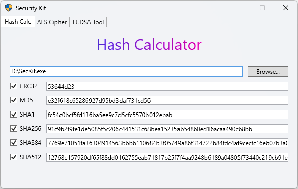
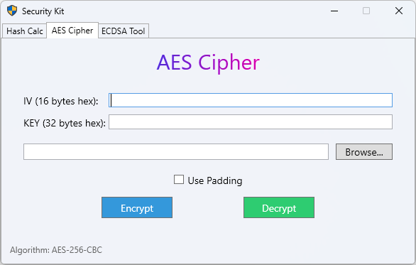
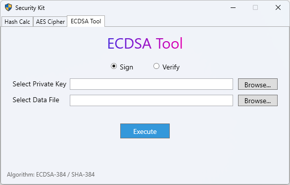
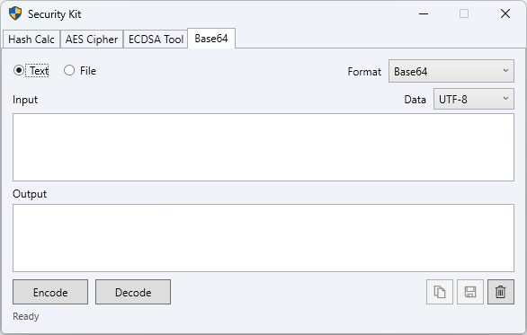

# Security Kit

Security Kit is a cryptographic and encoding toolkit featuring four tabs: **Hash Calculator**, **AES Cipher**, **ECDSA Tool**, and **Base64**.

---

## Features

### 1. Hash Calculator

- **Supported Algorithms:**
  - CRC32
  - MD5
  - SHA1
  - SHA256
  - SHA384
  - SHA512
- **Functionality:**
  - Calculate hash values for input data using any of the supported algorithms.
- **Keyboard Shortcuts (Hash Calculator tab only):**
  - `Ctrl + Shift + C`: Copy the hash result to the clipboard
  - `Ctrl + S`: Save the hash result to a file

- **Screenshot:**

---

### 2. AES Cipher

- **Supported Cipher:**
  - AES-256-CBC
- **Functionality:**
  - Encrypt or decrypt data using AES-256-CBC mode.
  - Support PKCS#7 padding.
  - Requires user-provided IV and Key.

- **Screenshot:**

---

### 3. ECDSA Tool

- **Supported Algorithm:**
  - ECDSA-384 with SHA-384
- **Functionality:**
  - Sign data using a selected ECDSA private key.
  - Verify signatures using a selected ECDSA public key.

- **Screenshot:**

---

### 4. Base64

- **Formats:** Standard Base64 (with padding) and Base64URL (without padding).
- **Text mode:** Paste input and choose Encode or Decode. The Data selector controls the raw data representation: UTF-8 or Hex. Encoding preserves whitespace in UTF-8 input and does not add a BOM. Hex input accepts spaces, tabs, and line breaks.
- **Binary results:** Invalid UTF-8 is displayed as Hex without changing the decoded bytes. Copy copies the displayed output; Save writes the original decoded bytes, including when the display is Hex. Encoded output is saved as ASCII without a BOM.
- **File mode:** Browse or drop a single file, choose Encode or Decode, then select the output location. Files are streamed with progress and cancellation; large results are not loaded into the text boxes. Input and output paths must differ. An existing output is replaced only after a successful conversion; failures and cancellation clean up temporary output where filesystem permissions allow.
- **Validation:** Decoding ignores ASCII spaces, tabs, CR, and LF. Invalid characters, mixed alphabets, and malformed padding are rejected. Standard Base64 requires padding where applicable; Base64URL accepts unpadded input. File decoding expects Base64 text without a BOM, Data URI prefix, or PEM headers.
- **Limits:** Text input is limited to 1,048,576 UTF-16 code units for conversion; use File mode for larger data. All processing is local, without a conversion history. Base64 is encoding, not encryption.
- **Keyboard shortcut:** `Ctrl + S` saves the current text-mode result.

---

## Getting Started

1. Launch the application.
2. Select the desired tab for your operation.
3. Follow the on-screen instructions for each tool.
4. Use keyboard shortcuts in the Hash Calculator tab for efficient workflow.

## Runtime and Development Environment
| OS                  | Windows Only                     |
|---------------------|----------------------------------|
| Runtime environment | Windows 11 Build 22621+ / .NET 10 Desktop Runtime |
| Development         | .NET 10 SDK; Visual Studio with .NET 10 support |
